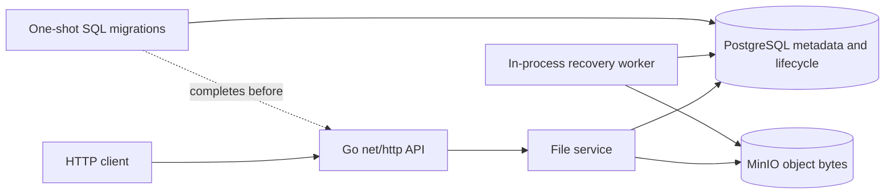
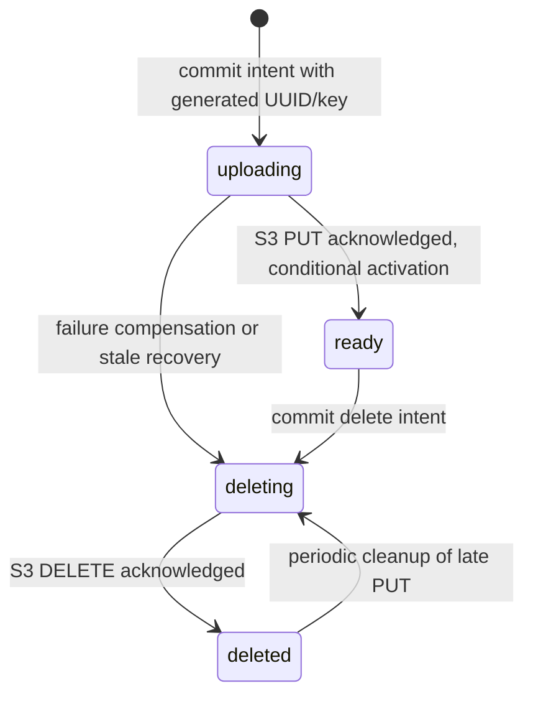

# FileStorage

[](https://github.com/GrimVeqsum/FileStorage/actions/workflows/ci.yml)

A small Go HTTP backend for uploading, listing, downloading and deleting files. PostgreSQL stores metadata and durable operation intent; MinIO stores file bytes. The project demonstrates recovery across two independent stores without a distributed transaction or additional services.



Stack: Go, `net/http`, `database/sql` + pgx, MinIO Go SDK, PostgreSQL 16, Docker Compose, SQL migrations, structured `slog` logging and GitHub Actions. There is no authentication: anyone who can reach the API can list, download and delete all files. The default host binding is loopback. Put access control, TLS, quotas and rate limiting at a trusted gateway before any public deployment.

## Quick start

Requires Docker Engine and Docker Compose v2.24.4+.

```bash
cp .env.example .env
# Set your local credentials in .env and keep DATABASE_URL aligned with POSTGRES_*.
docker compose up --build -d --wait
curl --fail http://localhost:8080/ready
```

`.env.example` contains development placeholders, not cloud credentials. Do not use its passwords on a shared or exposed installation. URL-encode reserved characters in `DATABASE_URL`. Keep `.env` out of Git. The default API address is `127.0.0.1:8080`; PostgreSQL and MinIO have no published host ports. The database hostname is `postgres`, and the MinIO endpoint is `minio:9000` inside Compose.

MinIO's community [security release](https://github.com/minio/minio/releases/tag/RELEASE.2025-10-15T17-29-55Z) is distributed as source. `deploy/minio.Dockerfile` builds that pinned release, rather than depending on `latest` or an unavailable binary image. The first build needs network access and takes longer. MinIO is AGPLv3; its license is included in the image. [Upstream](https://github.com/minio/minio) is archived; evaluate maintenance and licensing before production use.

For an existing installation, reuse its Compose project name/directory and **existing credentials**. Keep the `postgres_data` and `minio_data` volumes. Changing `POSTGRES_PASSWORD` does not change the password inside an initialized PostgreSQL volume. Migration 002 preserves existing rows and object keys as `ready`; it does not inspect or remove existing objects. Stop old application instances before applying the lifecycle migration: the old binary does not understand the new states. Back up both stores before upgrading. No automatic rollback or destructive reset is performed.

```bash
docker compose logs -f app
# Stop services while retaining data:
docker compose down
```

Never run `docker compose down -v` against your user project. `docker system prune` is not part of this workflow.

The application starts only after migrations complete, verifies its schema and bucket, and runs a recovery sweep immediately and every 15 seconds. `/health` is liveness; `/ready` checks the lifecycle schema through PostgreSQL and the existence/accessibility of the MinIO bucket with a three-second deadline. Missing dependencies return 503. Readiness checks connectivity and schema, not every individual object or all write permissions. The app's image runs as UID 10001 with a read-only root filesystem and a writable temporary filesystem. SIGINT/SIGTERM withdraw readiness, stop accepting connections and allow 30 seconds for requests, then close remaining connections and allow bounded compensation to drain. Unfinished operations remain recoverable.

## Configuration

| Variable | Purpose / default |
| --- | --- |
| `HTTP_PORT` | Application/container port, `8080` |
| `HTTP_BIND_ADDRESS` | Compose host binding, `127.0.0.1` |
| `POSTGRES_DB`, `POSTGRES_USER`, `POSTGRES_PASSWORD` | Compose database settings; match `DATABASE_URL` |
| `DATABASE_URL` | Required PostgreSQL URL; Compose uses hostname `postgres` |
| `MINIO_ENDPOINT` | Required host:port without scheme; Compose default `minio:9000` |
| `MINIO_ACCESS_KEY`, `MINIO_SECRET_KEY` | Required S3 credentials; local Compose uses these to configure MinIO |
| `MINIO_BUCKET` | Bucket name, `files`; created if absent during startup |
| `MINIO_USE_SSL` | Strict boolean, `false` for the private local Compose network |
| `MAX_FILE_SIZE_MB` | File limit in MiB, `20`; valid range 1–5120 |

Invalid configuration fails startup without printing secret values. Environment credentials are visible to trusted Docker administrators; this is local configuration, not a production secret manager. Native Go execution must use reachable host endpoints rather than Compose-only DNS; publish dependencies only through an explicit loopback development override if needed. Native build: `go build -o /tmp/filestorage ./cmd/app`, then run with the required environment variables.

## HTTP API

The existing routes and metadata JSON fields are preserved. Object keys and internal states are omitted from responses.

| Method / route | Result |
| --- | --- |
| `GET /health` | 200 `{"status":"ok"}` |
| `GET /ready` | 200 `{"status":"ready"}` or 503 |
| `POST /files` | One multipart part named `file`; 201 metadata and `Location: /files/{id}` |
| `GET /files` | 200 array of ready files, newest first; `[]` when empty |
| `GET /files/{id}` | 200 attachment with original bytes; 404 if absent or not ready |
| `DELETE /files/{id}` | 204 on completed deletion, including repeated / absent UUIDs |

```bash
printf 'hello\n' > /tmp/hello.txt
curl --fail-with-body -i -F 'file=@/tmp/hello.txt' http://localhost:8080/files
```

```http
HTTP/1.1 201 Created
Content-Type: application/json
Location: /files/56e05abc-398a-4466-842e-af5d8deaf290
```

```json
{"id":"56e05abc-398a-4466-842e-af5d8deaf290","original_name":"hello.txt","content_type":"text/plain; charset=utf-8","size":6,"created_at":"2026-10-31T12:00:00Z"}
```

Use the actual ID from your response:

```bash
curl --fail http://localhost:8080/files
curl --fail http://localhost:8080/files/56e05abc-398a-4466-842e-af5d8deaf290 -o /tmp/download.txt
cmp /tmp/hello.txt /tmp/download.txt
curl -i -X DELETE http://localhost:8080/files/56e05abc-398a-4466-842e-af5d8deaf290
```

Uploads accept exactly one multipart file and reject extra fields/parts. Empty files return 400, preserving the original API policy. File bytes may equal the configured limit; the complete HTTP body has a separate strict limit of file limit + 1 MiB for multipart framing. Oversized files or bodies return 413, including streamed requests without Content-Length. Multipart parsing streams into a temporary file; it does not buffer the entire file in Go memory. At most eight uploads spool/run per process; saturation returns 503. Temporary files are closed and removed on every exit and unlinked immediately on Unix so a killed process cannot accumulate named spool files. Compose's temporary filesystem is discarded on container stop.

The default 256 MiB Compose tmpfs accommodates eight default 20 MiB uploads plus overhead. Tmpfs consumes host memory. If raising the maximum file size, explicitly increase temporary storage and provide sufficient memory/disk; the 5120 MiB configuration ceiling is a protocol bound, not a promise that the default container can hold that file. The storage client uses a single streaming PUT, avoiding incomplete S3 multipart-upload parts after a process crash. Seekable HTTP spool files get a Content-MD5 integrity check. The service stores arbitrary bytes; it cannot detect semantically damaged documents or malware.

Names are reduced to a basename for both slash conventions. Controls including CRLF, invalid UTF-8 and overlong names are rejected. Storage keys are generated UUIDs, independent of names or extensions. Content-Type is detected from the first 512 bytes, not trusted from the client. Downloads use `mime.FormatMediaType` for quoted or RFC 2231 UTF-8 filenames, verified Content-Length and `X-Content-Type-Options: nosniff`. Legacy unsafe names get a safe fallback. S3 stat and the initial read happen before HTTP 200; missing objects, size mismatches and early read failures return 503. A later streaming failure aborts the connection: a status already sent cannot be replaced.

Header reads are bounded to five seconds and 32 KiB. Body reads and foreground database/S3 operations have two-minute bounds; download S3 reads use a two-minute context. A stalled client socket write is bounded by the server write deadline, which covers body reception plus upload and response (4 minutes 15 seconds). These are deliberate limits for a small service, not a resumable transfer protocol.

Errors use stable JSON without driver details or credentials:

```json
{"error":"file_too_large","message":"file is too large"}
```

| HTTP status | Typical cause |
| --- | --- |
| 400 | Empty file, malformed multipart, unsafe name or invalid UUID |
| 404 | Download of absent/non-ready file |
| 413 | File or total request exceeds limit |
| 503 | Dependency failure, interrupted operation, upload saturation or in-progress conflicting transition |

## Consistency and recovery



Each transition is an atomic PostgreSQL statement. There is no SQL transaction held open over network I/O. Only `ready` rows are listed/downloaded. Upload writes a durable `uploading` row **before** attempting S3. A 201 response means PUT succeeded and activation committed. If activation returns an error after actually committing, compensation may only claim `uploading → deleting`; it cannot delete an already-ready object. Cancellation runs compensation with a separate five-second context. If compensation itself fails or the process dies, durable intent survives.

Delete commits the hidden `deleting` state before removing the object, then marks it `deleted`. Repeated/concurrent deletes issue idempotent S3 removal; retryable dependency failures return 503 and remain recoverable. A download racing deletion may fail; it does not lock the file for the entire transfer.

The worker claims up to 32 eligible rows atomically using `FOR UPDATE SKIP LOCKED`. Uploads become eligible after three minutes, beyond the two-minute foreground lifetime. Claim queries and per-file cleanup have five-second contexts. Claims move the next retry three minutes forward; completed tombstones are due again in five minutes. Failed calls remain scheduled. Multiple workers share claims, and due-time ordering avoids a fixed first batch monopolizing every sweep. Recovery latency depends on backlog and dependency health.

Deleted metadata is retained indefinitely as a cleanup tombstone. S3 can finish a PUT after a lost acknowledgement or client disconnect, even after a compensation DELETE. Periodically repeating DELETE for that key removes such late writes. Reconciliation does not reactivate abandoned uploads and never claims a ready row.

| Failure window | Durable state and recovery |
| --- | --- |
| SQL intent fails, including lost insert acknowledgement | No PUT attempted; any committed `uploading` row expires and is cleaned |
| PUT fails or succeeds without acknowledgement | Hidden intent; bounded compensation, then durable repeated cleanup |
| Crash after PUT before activation | Stale `uploading` becomes `deleting`; object is removed |
| Activation committed but acknowledgement lost | File remains `ready`; compensation cannot claim/delete it; client must check the list |
| SQL delete intent fails before commit | Object stays available; retry DELETE |
| Delete intent committed without acknowledgement / crash before S3 DELETE | Hidden `deleting` row; worker completes removal |
| S3 DELETE fails, succeeds without acknowledgement, or final SQL update fails | Hidden row is retried; removal is idempotent |
| PUT arrives after earlier cleanup | Retained tombstone repeats removal |
| Process restarts | Ready files survive; durable pending work is swept |

This is eventual recovery, **not** exactly-once delivery or full atomicity across PostgreSQL and S3. Retrying a POST whose response was lost creates another file: there is no client idempotency-key API. A failed request may already have committed a ready file, so clients should inspect the list. Success cannot guarantee future availability after external object deletion or dependency outages.

Migration 002 is transactional and defaults legacy rows to ready without deleting data. Rollback refuses while non-ready rows exist, preventing accidental resurrection. A large installation should schedule its schema/index locks in a maintenance window; these are ordinary transactional indexes, not zero-downtime concurrent indexes. Never roll back through migration 001 against data you intend to retain.

## Tests and CI

Use Go 1.26.10 (the pinned CI/container version; go.mod's declared minimum is 1.25.5) and a C compiler for the race detector.

```bash
gofmt -l $(git ls-files '*.go')
go vet ./...
go test -count=1 ./...
go test -race -count=1 ./...
go build ./...
docker compose --env-file .env.example config --quiet
docker compose --env-file /dev/null -f docker-compose.test.yml config --quiet
docker build -t filestorage:local .
./scripts/test-integration.sh -race -v
```

Ordinary unit tests use fault injection and local HTTP S3 fixtures. Integration tests use **real PostgreSQL and MinIO**, tagged `integration`, with an isolated schema and bucket. `scripts/test-integration.sh` creates a unique Compose project, ignores the developer's `.env`, assigns dynamic loopback ports and exports only `TEST_*` configuration. Its EXIT trap removes only that run's test containers/network/volumes. Test-only credentials are explicit disposable values. It never targets user volumes or container names.

The suite checks byte roundtrips, boundaries, multipart/headers/names, cancellation, concurrent deletes/claims, lost acknowledgements, failing dependencies, stale intermediate states, late PUT cleanup, migration preservation/rollback refusal, and a real application restart with successful SIGTERM shutdown. Precise commit/acknowledgement failures use wrappers around real stores; this is distinct from physically interrupting a database commit or injecting power loss. See [executed verification](docs/VERIFICATION.md) for actual local results and limits.

[GitHub Actions](.github/workflows/ci.yml) checks formatting, vet, unit/race tests, native build, both Compose configurations, Docker image build and the real integration suite. It needs no cloud credentials or local developer files. The badge becomes meaningful after the workflow is committed and run; no remote run is claimed here.

## Tradeoffs and remaining limits

- No users, tenant isolation, authentication, global storage quota or persistent rate limiting. The eight-upload bound is per process, not a fleet-wide quota.
- Tombstones and ready metadata grow indefinitely; listing is unpaginated and recovery uses bounded batches. This favors a transparent recovery model over scale. Monitor storage and database growth.
- No resumable upload, range download, custom checksum manifest or antivirus scanning. Very large/slow transfers can exceed fixed deadlines.
- Use an unversioned, application-owned bucket. Versioning, object retention/locks and external writers/deleters need a separate operational design. A regular DELETE does not purge old versions.
- Recovery covers objects created through the new durable-intent path. Old orphan objects are not blindly deleted; audit them manually. Existing ready rows with already-missing objects are not repaired automatically.
- A same-size out-of-band overwrite cannot be detected from metadata size alone. Protect direct bucket access and back up PostgreSQL and MinIO together.
- TLS termination, database TLS and production secrets/least-privilege S3 IAM policies are deployment responsibilities. Local MinIO uses its administrator account for simplicity.
- Pinned release tags improve repeatability but are not immutable digest locks or a security maintenance guarantee. MinIO upstream is archived. Native Windows abrupt crashes may leave a named spool file if the OS disallows unlinking an open file; the container deployment uses Linux/tmpfs.

Repository layout: `cmd/app` lifecycle; `internal/files` HTTP/service/repository; `internal/storage` S3 adapter; `internal/config` validation; `migrations` compatible SQL; `integration` real-store scenarios; `scripts` isolated test runner; `docs` audit and verification. See [audit](docs/AUDIT.md) for the original findings.
